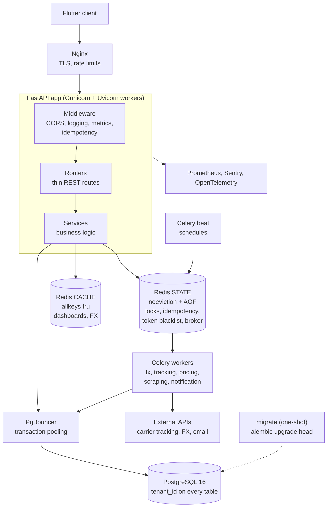

# System Architecture

## 1. Overview

A multi-tenant, containerised backend. A Flutter client calls a versioned REST API.
The API holds no state; everything durable is in PostgreSQL, everything slow runs in
Celery workers, and two Redis instances with different jobs keep critical state apart
from disposable cache.



## 2. Layers and responsibilities

| Layer | Responsibility | Rule |
|-------|----------------|------|
| Nginx | TLS, request-size and rate limits (login 5/min, tracking 20/min, API 100/min) | The API is never exposed directly |
| Middleware | CORS (outermost), request ID + structured logs, Prometheus metrics, idempotency (innermost) | Starlette wraps in reverse: the last middleware added is the outermost |
| Routers | Parse and validate input (Pydantic), authenticate, authorise by role, map errors to HTTP | No business logic |
| Services | Business rules, transactions, tenant checks, calls to external systems | The only layer that touches the database |
| Models / schemas | SQLAlchemy tables; Pydantic request and response types | Money is Decimal everywhere |
| Workers | Slow and scheduled work: FX refresh, tracking, scraping, pricing, notifications | One queue per workload |

## 3. Request flow (example: add an expense)

1. Nginx applies rate limits and forwards to a Gunicorn worker.
2. Middleware stack: CORS, request ID/logging, metrics, then idempotency (reads the body, claims the `Idempotency-Key`).
3. The router validates the body (`PositiveMoney`, 4 decimal places max) and the dependency authenticates the JWT (blacklist check in state Redis, then user lookup) and checks the role.
4. `ContainerService` verifies the container belongs to the caller's tenant (clerks: only their own), fetches the FX rate **before** opening a transaction, then writes the expense in one transaction.
5. The response is returned; the idempotency middleware stores a 2xx response so a retry replays it.

## 4. Background work

```
Celery beat --(hourly)--> fx_queue / tracking_queue / notification_queue   (state Redis broker)
                          analytics every 6 hours
worker --> distributed lock (so overlapping runs cannot collide)
       --> service call (external API or database)
       --> result persisted in PostgreSQL
```

* Queues: `fx_queue`, `tracking_queue`, `pricing_queue`, `scraping_queue`, `notification_queue`, default.
  Slow scraping cannot delay tracking.
* `acks_late` + `reject_on_worker_lost` + prefetch 1: a crashed worker's task is redelivered, so tasks must be safe to repeat.
* Locks use `SET NX EX` and a Lua compare-and-delete release, so a worker never frees a lock it no longer owns.

## 5. Data model (simplified)

```
Organization (tenant) 1--* User
                      1--* Container 1--* Item        (soft delete)
                                     1--* ContainerExpense
                                     1--* TrackingRecord
Item 1--* PriceRecord        Item 1--0..1 Sale
```

* `tenant_id` on every business table with composite indexes such as `(tenant_id, owner_id)`.
* The carrier container number is unique **per tenant**, not globally.
* Check constraints: expense amount > 0, item price > 0, item weight > 0.
* Money `NUMERIC(18,4)`, FX rate `NUMERIC(18,8)`, weight/volume `NUMERIC(12,3)`.

## 6. Redis: two roles, never mixed

| Instance | Holds | Policy | Why |
|----------|-------|--------|-----|
| **State** (`REDIS_URL`) | Celery broker and results, locks, idempotency records, token blacklist, login-lockout counters | `noeviction`, AOF persistence, password | Evicting any of these silently breaks correctness or security |
| **Cache** (`CACHE_REDIS_URL`) | Dashboard summaries, FX rates | `allkeys-lru`, no persistence | Losing it only costs extra queries |

Clients are shared per event loop (`app/core/redis_clients.py`) instead of opening a connection per call.

## 7. Idempotency design

State machine in `app/core/idempotency.py`, glue in `app/middleware/idempotency_middleware.py`:

```
claim (SET NX) --won--> run endpoint --2xx--> complete (store response, 24h)
      |                          \--other / exception--> release (client may retry)
      \--lost--> same fingerprint & completed  -> replay
                 same fingerprint & running    -> 409
                 different fingerprint         -> 422
```

* Key = tenant + user (from the **verified** JWT) + hash of the client key; the request fingerprint is a SHA-256 of method, path, query and body.
* Completion and release are Lua scripts that check ownership, so a slow request cannot overwrite a newer one after its claim expired.
* **Durable by default:** the store is PostgreSQL (`idempotency_keys`, UNIQUE on `key`). The claim is `INSERT ... ON CONFLICT DO NOTHING`, committed before the endpoint runs, so exactly one concurrent request wins and a Redis flush or restart cannot let a duplicate through. Expired claims (a crashed request) can be taken over; a nightly Celery task purges old rows. Set `IDEMPOTENCY_BACKEND=redis` for the faster, less durable variant.
* **Remaining window (honest):** the idempotency record is completed after the endpoint commits. If the process dies in between, the claim expires after `IDEMPOTENCY_LOCK_TTL` and a retry would run again. Closing that fully needs the record written inside the business transaction, or a natural unique key on the business row (for example a unique provider reference on a payment).

## 8. Money handling

`app/utils/money.py` is the single place for money rules:
`to_decimal` (floats go through `str`), `quantize` (banker's rounding), `convert` (amount x rate),
and `allocate_proportionally` (largest remainder: parts always sum to the total).
Cost allocation locks the container row, runs in one transaction, and checks the invariant before commit.
Reports use one definition everywhere: revenue and cost of goods sold count SOLD items only, profit = revenue - cost of goods sold, and unsold stock is shown separately as inventory value (it used to be subtracted as if lost). Expenses and items are aggregated separately before joining, so totals are not multiplied. FX rates are cached for one hour; if no rate can be obtained, production fails with 503 instead of using a stale hard-coded number.

## 9. Security

* JWT access and refresh tokens, refresh rotation, logout blacklist (stores a hash, not the token).
* Roles: admin, manager, clerk, viewer. Services filter by `tenant_id`; the allocation integration test checks cross-tenant access, and broader tenant-isolation tests are still to be written.
* Login lockout (Redis counters) plus Nginx and application rate limits.
* Production start-up validation: strong `SECRET_KEY`, no default database credentials, `DEBUG=false`.
* Sentry with `send_default_pii=false`; readiness errors are logged, never returned to callers.
* Uploads: size limit and MIME-type allow-list.

## 9a. Audit trail and tenant onboarding

* `audit_logs` records who did what to which record: action, entity, before/after values (Decimals as exact strings), client IP and user agent.
  `AuditService.add()` stages the row in the **same transaction** as the change, so the two commit or roll back together.
  Client IP comes from `X-Real-IP` only when `TRUST_PROXY_HEADERS=true` (behind Nginx), so it cannot be forged.
* Organisations are created by a platform administrator (`POST /organizations/`), which creates the tenant and its first admin atomically.
  There is no public sign-up. User-management endpoints are scoped to the caller's own tenant.

## 9b. Pricing and authorisation

* Price recommendations come from a robust, explainable engine (`app/utils/pricing_math.py`, see `PRICING.md`): USD-normalised comparables, outlier removal, recency and source weights, blended with cost-plus by a trust score, with a minimum-margin floor.
* Every endpoint that takes a record id resolves it through a tenant-scoped (and for clerks, owner-scoped) lookup **before** doing work or enqueueing a job; background jobs receive the tenant id and re-check it. Uploaded files are stored under `<tenant>/<user>/<random>`, validated against a strict key pattern, and served only through an authenticated endpoint.

## 10. Observability

JSON logs with request ID in production, Prometheus metrics at `/metrics`, Sentry, optional OpenTelemetry,
`/health` (liveness) and `/ready` (database + migrated schema + state Redis; cache and Celery are reported but non-fatal).

## 11. Deployment

`docker/docker-compose.prod.yml`: `db`, `pgbouncer`, `redis` (state), `redis-cache`, `migrate` (one-shot),
`web` (2 replicas), per-queue Celery workers, `beat`, `nginx`, `flower`, `prometheus`, `grafana`.
The API starts only after `migrate` completes successfully.

## 12. Known limitations and next steps

* Market prices are scraped estimates; see `PRICING.md` for the engine's limits.
* Carrier tracking has only been exercised with mock data.
* Write the idempotency record inside the business transaction for payment-like operations (see section 7).
* Add row-level security in PostgreSQL as a second tenant-isolation layer.
* Pricing recommendations are returned as floats (they are estimates); stored prices and all report amounts are Decimal.
