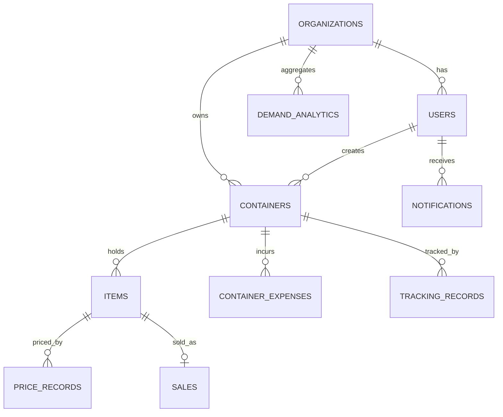

# Database Design

PostgreSQL 16, accessed through async SQLAlchemy 2 and migrated with Alembic.
The table definitions in section 5 were generated from `app/models/*.py`, so they match the code.

> **Schema management:** `alembic/versions/001_baseline.py` creates the schema below. It is verified on a real PostgreSQL 16 (`bash scripts/verify_migrations.sh`) and also checked offline by `scripts/check_migration.py`. After every model change run `alembic revision --autogenerate -m "describe change"`; CI runs `alembic check` and `scripts/check_migration.py` to catch forgotten migrations.

## 1. Conventions

* **Every table** inherits `id` (integer primary key), `created_at` and `updated_at` (timestamptz, set by the database).
* **Multi-tenancy:** every business table has `tenant_id` -> `organizations.id`. All queries filter by it.
* **Soft delete:** tables marked "soft delete" have `deleted_at`; queries must filter `deleted_at IS NULL`.
* **Money:** `NUMERIC(18,4)`; FX rates `NUMERIC(18,8)`; weight and volume `NUMERIC(12,3)`. All amounts are also stored in USD (`*_usd`) next to the original currency and the rate used.
* **Enums** are PostgreSQL enum types (values in section 4).
* **Deletes:** parent -> child relations use `ON DELETE CASCADE` for owned data (items of a container), `RESTRICT` where history must be preserved (items referenced by orders), `SET NULL` for optional links.

## 2. Entity relationships (tables that the API uses today)



## 3. How cost allocation uses the data

```
container_expenses.amount_usd  --sum-->  total expenses of the container
items.weight (or purchase_price_usd) --> each item's share = total x item_basis / sum(bases)   (largest remainder, exact)
items.allocated_cost = share            items.landed_cost = purchase_price_usd + allocated_cost
sales.price vs items.landed_cost        --> profit and margin in reports
```

Re-run allocation after editing an item's price/weight or any expense.

## 4. Enumerations

| Enum | Values |
|---|---|
| `NotificationType` | `tracking_update`, `price_change`, `low_stock`, `container_arrived`, `payment_received`, `system` |
| `OrderStatus` | `pending`, `confirmed`, `fulfilled`, `canceled` |
| `PaymentMethod` | `cash`, `bank_transfer`, `card`, `stripe`, `other` |
| `ContainerType` | `20ft`, `40ft` |
| `AllocationMethod` | `weight_based`, `value_based` |
| `ExpenseType` | `loading_fee`, `shipping_fee`, `clearing_fee`, `offloading_fee`, `warehouse_fee`, `security_fee`, `extra_fee` |
| `ItemCondition` | `new`, `tokunbo`, `used` |
| `ItemCategory` | `electronics`, `vehicles`, `engines`, `appliances`, `food_items`, `laptops`, `other` |
| `ShipmentStatus` | `booked`, `in_transit`, `arrived`, `delivered`, `delayed` |
| `TransportType` | `sea`, `air`, `road`, `rail` |
| `DocumentType` | `bill_of_lading`, `customs_form`, `invoice`, `inspection_report`, `packing_list`, `insurance`, `other` |
| `ClearanceStatus` | `pending`, `in_review`, `cleared`, `held`, `rejected` |
| `PricingMethod` | `cost_based`, `market_based`, `last_sold` |
| `PricingSource` | `jiji`, `ebay`, `mobile_de`, `autoscout24`, `bazos_cz` |
| `TrackingStatus` | `booked`, `gate_in`, `loaded`, `departed`, `in_transit`, `arrived`, `discharged`, `gate_out`, `delivered`, `unknown` |
| `UserRole` | `admin`, `manager`, `clerk`, `viewer` |
| `MovementType` | `in`, `out`, `transfer`, `adjust` |

## 5. Tables

Every table also has `id`, `created_at`, `updated_at` (not repeated below).

### `exchange_rate_history`

`ExchangeRateHistory` in `app/models/analytics.py`

| Column | Type | Null | Notes |
|---|---|---|---|
| `from_currency` | String(3) | NOT NULL |  |
| `to_currency` | String(3) | NOT NULL |  |
| `rate` | Numeric(18, 8) | NOT NULL |  |
| `date` | Date | NOT NULL |  |
| `source` | String(50) | NULL |  |

- UniqueConstraint: `from_currency, to_currency, date`
- Index `ix_fx_from_to_date` on (from_currency, to_currency, date)

### `notifications`

`Notification` in `app/models/analytics.py`

| Column | Type | Null | Notes |
|---|---|---|---|
| `tenant_id` | Integer | NOT NULL | FK -> organizations.id, cascade; indexed |
| `user_id` | Integer | NOT NULL | FK -> users.id, cascade; indexed |
| `notification_type` | Enum(NotificationType) | NOT NULL |  |
| `title` | String(255) | NOT NULL |  |
| `message` | Text | NOT NULL |  |
| `read` | Boolean | NOT NULL | default False |
| `data` | JSONB | NULL |  |

- Index `ix_notification_user_read` on (user_id, read)

### `audit_logs`

`AuditLog` in `app/models/analytics.py`

| Column | Type | Null | Notes |
|---|---|---|---|
| `tenant_id` | Integer | NOT NULL | FK -> organizations.id, cascade; indexed |
| `user_id` | Integer | NULL | FK -> users.id; indexed |
| `action` | String(100) | NOT NULL |  |
| `entity_type` | String(100) | NULL |  |
| `entity_id` | Integer | NULL |  |
| `ip_address` | String(45) | NULL |  |
| `user_agent` | String(512) | NULL |  |
| `extra_data` | JSONB | NULL |  |

- Index `ix_auditlog_tenant_action` on (tenant_id, action)
- Index `ix_auditlog_tenant_entity` on (tenant_id, entity_type, entity_id)
- Index `ix_auditlog_created_at` on (created_at)

### `demand_analytics`

`DemandAnalytics` in `app/models/analytics.py`

| Column | Type | Null | Notes |
|---|---|---|---|
| `tenant_id` | Integer | NOT NULL | FK -> organizations.id, cascade; indexed |
| `item_category` | String(100) | NOT NULL |  |
| `avg_market_price` | Numeric(14, 2) | NULL |  |
| `avg_sale_price` | Numeric(14, 2) | NULL |  |
| `avg_margin` | Float | NULL |  |
| `demand_score` | Float | NULL |  |
| `units_sold_30d` | Integer | NOT NULL | default 0 |
| `units_sold_90d` | Integer | NOT NULL | default 0 |
| `updated_at_calc` | DateTime(timezone=True) | NULL |  |
| `extra_data` | JSONB | NULL |  |

- UniqueConstraint: `tenant_id, item_category`
- Index `ix_demand_tenant_category` on (tenant_id, item_category)

### `customers`

`Customer` in `app/models/commerce.py` - soft delete

| Column | Type | Null | Notes |
|---|---|---|---|
| `tenant_id` | Integer | NOT NULL | FK -> organizations.id, cascade; indexed |
| `name` | String(255) | NOT NULL |  |
| `email` | String(255) | NULL | indexed |
| `phone` | String(50) | NULL |  |
| `address` | Text | NULL |  |
| `notes` | Text | NULL |  |

### `suppliers`

`Supplier` in `app/models/commerce.py` - soft delete

| Column | Type | Null | Notes |
|---|---|---|---|
| `tenant_id` | Integer | NOT NULL | FK -> organizations.id, cascade; indexed |
| `supplier_name` | String(255) | NOT NULL |  |
| `country` | String(100) | NULL |  |
| `contact_info` | Text | NULL |  |
| `email` | String(255) | NULL |  |
| `phone` | String(50) | NULL |  |
| `rating` | Float | NULL |  |
| `is_active` | Boolean | NOT NULL | default True |
| `extra_data` | JSONB | NULL |  |

### `orders`

`Order` in `app/models/commerce.py`

| Column | Type | Null | Notes |
|---|---|---|---|
| `tenant_id` | Integer | NOT NULL | FK -> organizations.id, cascade; indexed |
| `customer_id` | Integer | NOT NULL | FK -> customers.id; indexed |
| `created_by_id` | Integer | NOT NULL | FK -> users.id |
| `status` | Enum(OrderStatus) | NOT NULL | default OrderStatus.PENDING |
| `total` | Numeric(14, 2) | NULL |  |
| `currency` | String(3) | NOT NULL | default 'USD' |
| `notes` | Text | NULL |  |

- Index `ix_order_tenant_customer` on (tenant_id, customer_id)
- Index `ix_order_tenant_status` on (tenant_id, status)

### `order_items`

`OrderItem` in `app/models/commerce.py`

| Column | Type | Null | Notes |
|---|---|---|---|
| `order_id` | Integer | NOT NULL | FK -> orders.id, cascade; indexed |
| `item_id` | Integer | NOT NULL | FK -> items.id; indexed |
| `quantity` | Integer | NOT NULL |  |
| `price` | Numeric(14, 2) | NOT NULL |  |
| `currency` | String(3) | NOT NULL | default 'USD' |

### `payments`

`Payment` in `app/models/commerce.py`

| Column | Type | Null | Notes |
|---|---|---|---|
| `tenant_id` | Integer | NOT NULL | FK -> organizations.id, cascade; indexed |
| `container_id` | Integer | NULL | FK -> containers.id; indexed |
| `order_id` | Integer | NULL | FK -> orders.id; indexed |
| `amount` | Numeric(14, 2) | NOT NULL |  |
| `currency` | String(3) | NOT NULL | default 'USD' |
| `payment_method` | Enum(PaymentMethod) | NOT NULL |  |
| `paid_at` | DateTime(timezone=True) | NULL |  |
| `reference` | String(255) | NULL |  |
| `notes` | Text | NULL |  |

### `sales`

`Sale` in `app/models/commerce.py`

| Column | Type | Null | Notes |
|---|---|---|---|
| `tenant_id` | Integer | NOT NULL | FK -> organizations.id, cascade; indexed |
| `item_id` | Integer | NOT NULL | FK -> items.id; UNIQUE; indexed |
| `customer_id` | Integer | NULL | FK -> customers.id |
| `sold_by` | Integer | NOT NULL | FK -> users.id |
| `sale_price` | Numeric(14, 2) | NOT NULL |  |
| `currency` | String(3) | NOT NULL | default 'USD' |
| `sold_at` | DateTime(timezone=True) | NOT NULL |  |
| `notes` | Text | NULL |  |

- Index `ix_sale_tenant_sold_at` on (tenant_id, sold_at)

### `containers`

`Container` in `app/models/container.py` - soft delete

| Column | Type | Null | Notes |
|---|---|---|---|
| `tenant_id` | Integer | NOT NULL | FK -> organizations.id, cascade; indexed |
| `name` | String(255) | NOT NULL |  |
| `container_type` | Enum(ContainerType) | NOT NULL |  |
| `msc_container_number` | String(50) | NULL | indexed |
| `allocation_method` | Enum(AllocationMethod) | NOT NULL | default AllocationMethod.WEIGHT_BASED |
| `allocation_override` | Boolean | NOT NULL | default False |
| `is_sealed` | Boolean | NOT NULL | default False |
| `is_shipped` | Boolean | NOT NULL | default False |
| `owner_id` | Integer | NOT NULL | FK -> users.id; indexed |
| `notes` | Text | NULL |  |
| `extra_data` | JSONB | NULL |  |

- Index `ix_container_tenant_owner` on (tenant_id, owner_id)
- Index `ix_container_tenant_shipped` on (tenant_id, is_shipped)
- UniqueConstraint: `tenant_id, msc_container_number`

### `container_expenses`

`ContainerExpense` in `app/models/expense.py`

| Column | Type | Null | Notes |
|---|---|---|---|
| `tenant_id` | Integer | NOT NULL | FK -> organizations.id, cascade; indexed |
| `container_id` | Integer | NOT NULL | FK -> containers.id, cascade; indexed |
| `expense_type` | Enum(ExpenseType) | NOT NULL |  |
| `amount` | Numeric(18, 4) | NOT NULL |  |
| `currency` | String(3) | NOT NULL | default 'USD' |
| `description` | Text | NULL |  |
| `fx_rate_to_usd` | Numeric(18, 8) | NOT NULL | default Decimal('1') |
| `amount_usd` | Numeric(18, 4) | NOT NULL |  |

- Index `ix_expense_container_id` on (container_id)
- Index `ix_expense_tenant_id` on (tenant_id)
- CheckConstraint: `amount > 0`
- CheckConstraint: `amount_usd >= 0`

### `idempotency_keys`

`IdempotencyKey` in `app/models/idempotency.py`

| Column | Type | Null | Notes |
|---|---|---|---|
| `key` | String(255) | NOT NULL | UNIQUE |
| `fingerprint` | String(64) | NOT NULL |  |
| `state` | String(16) | NOT NULL |  |
| `owner` | String(32) | NOT NULL |  |
| `response` | JSONB | NULL |  |
| `expires_at` | DateTime(timezone=True) | NOT NULL |  |

- Index `ix_idempotency_expires_at` on (expires_at)

### `items`

`Item` in `app/models/item.py` - soft delete

| Column | Type | Null | Notes |
|---|---|---|---|
| `tenant_id` | Integer | NOT NULL | FK -> organizations.id, cascade; indexed |
| `container_id` | Integer | NOT NULL | FK -> containers.id, cascade; indexed |
| `name` | String(255) | NOT NULL |  |
| `description` | Text | NULL |  |
| `category` | Enum(ItemCategory) | NOT NULL |  |
| `condition` | Enum(ItemCondition) | NOT NULL |  |
| `purchase_price` | Numeric(18, 4) | NOT NULL |  |
| `purchase_currency` | String(3) | NOT NULL |  |
| `purchase_date` | Date | NULL |  |
| `fx_rate_to_usd` | Numeric(18, 8) | NOT NULL | default Decimal('1') |
| `purchase_price_usd` | Numeric(18, 4) | NOT NULL |  |
| `weight` | Numeric(12, 3) | NOT NULL |  |
| `volume` | Numeric(12, 3) | NULL |  |
| `allocated_cost` | Numeric(18, 4) | NOT NULL | default Decimal('0') |
| `landed_cost` | Numeric(18, 4) | NOT NULL | default Decimal('0') |
| `recommended_price` | Numeric(18, 4) | NULL |  |
| `selling_price` | Numeric(18, 4) | NULL |  |
| `sold` | Boolean | NOT NULL | default False |
| `sold_date` | Date | NULL |  |
| `extra_data` | JSONB | NULL |  |

- Index `ix_item_tenant_category` on (tenant_id, category)
- Index `ix_item_tenant_sold` on (tenant_id, sold)
- Index `ix_item_container_id` on (container_id)
- CheckConstraint: `purchase_price > 0`
- CheckConstraint: `weight > 0`

### `shipments`

`Shipment` in `app/models/logistics.py`

| Column | Type | Null | Notes |
|---|---|---|---|
| `tenant_id` | Integer | NOT NULL | FK -> organizations.id, cascade; indexed |
| `container_id` | Integer | NOT NULL | FK -> containers.id, cascade; indexed |
| `shipment_number` | String(100) | NOT NULL | UNIQUE |
| `carrier` | String(100) | NULL |  |
| `tracking_number` | String(100) | NULL |  |
| `origin_port` | String(100) | NULL |  |
| `destination_port` | String(100) | NULL |  |
| `departure_date` | DateTime(timezone=True) | NULL |  |
| `arrival_date` | DateTime(timezone=True) | NULL |  |
| `eta` | DateTime(timezone=True) | NULL |  |
| `status` | Enum(ShipmentStatus) | NOT NULL | default ShipmentStatus.BOOKED |
| `extra_data` | JSONB | NULL |  |

### `ports`

`Port` in `app/models/logistics.py`

| Column | Type | Null | Notes |
|---|---|---|---|
| `port_name` | String(255) | NOT NULL |  |
| `country` | String(100) | NOT NULL |  |
| `port_code` | String(10) | NOT NULL | UNIQUE; indexed |
| `latitude` | Float | NULL |  |
| `longitude` | Float | NULL |  |
| `is_active` | (from annotation) | NOT NULL | default True |

### `transport_legs`

`TransportLeg` in `app/models/logistics.py`

| Column | Type | Null | Notes |
|---|---|---|---|
| `container_id` | Integer | NOT NULL | FK -> containers.id, cascade; indexed |
| `shipment_id` | Integer | NULL | FK -> shipments.id; indexed |
| `from_port` | String(100) | NOT NULL |  |
| `to_port` | String(100) | NOT NULL |  |
| `transport_type` | Enum(TransportType) | NOT NULL |  |
| `departure_time` | DateTime(timezone=True) | NULL |  |
| `arrival_time` | DateTime(timezone=True) | NULL |  |
| `carrier` | String(100) | NULL |  |
| `notes` | Text | NULL |  |

### `documents`

`Document` in `app/models/logistics.py`

| Column | Type | Null | Notes |
|---|---|---|---|
| `tenant_id` | Integer | NOT NULL | FK -> organizations.id, cascade; indexed |
| `container_id` | Integer | NULL | FK -> containers.id, cascade; indexed |
| `uploaded_by` | Integer | NOT NULL | FK -> users.id |
| `document_type` | Enum(DocumentType) | NOT NULL |  |
| `file_name` | String(255) | NOT NULL |  |
| `file_url` | Text | NOT NULL |  |
| `file_size` | Integer | NOT NULL |  |
| `mime_type` | String(100) | NOT NULL |  |
| `notes` | Text | NULL |  |

- Index `ix_document_tenant_container` on (tenant_id, container_id)

### `customs_clearance`

`CustomsClearance` in `app/models/logistics.py`

| Column | Type | Null | Notes |
|---|---|---|---|
| `tenant_id` | Integer | NOT NULL | FK -> organizations.id, cascade; indexed |
| `container_id` | Integer | NOT NULL | FK -> containers.id, cascade; indexed |
| `clearance_status` | Enum(ClearanceStatus) | NOT NULL | default ClearanceStatus.PENDING |
| `tax_paid` | Numeric(12, 2) | NULL |  |
| `currency` | String(3) | NOT NULL | default 'USD' |
| `clearance_date` | DateTime(timezone=True) | NULL |  |
| `agent_name` | String(255) | NULL |  |
| `agent_contact` | String(255) | NULL |  |
| `notes` | Text | NULL |  |
| `extra_data` | JSONB | NULL |  |

### `organizations`

`Organization` in `app/models/organization.py`

| Column | Type | Null | Notes |
|---|---|---|---|
| `name` | String(255) | NOT NULL |  |
| `slug` | String(100) | NOT NULL | UNIQUE; indexed |
| `description` | Text | NULL |  |
| `is_active` | Boolean | NOT NULL | default True |
| `plan` | String(50) | NOT NULL | default 'starter' |
| `max_users` | (from annotation) | NOT NULL | default 5 |
| `max_containers` | (from annotation) | NOT NULL | default 50 |

### `price_records`

`PriceRecord` in `app/models/pricing.py`

| Column | Type | Null | Notes |
|---|---|---|---|
| `tenant_id` | Integer | NOT NULL | FK -> organizations.id, cascade; indexed |
| `item_id` | Integer | NOT NULL | FK -> items.id, cascade; indexed |
| `user_id` | Integer | NOT NULL | FK -> users.id; indexed |
| `method` | Enum(PricingMethod) | NOT NULL |  |
| `source` | Enum(PricingSource) | NULL |  |
| `price` | Numeric(18, 4) | NOT NULL |  |
| `currency` | String(3) | NOT NULL | default 'USD' |
| `source_url` | Text | NULL |  |
| `source_data` | JSONB | NULL |  |
| `confidence_score` | Float | NULL |  |
| `margin_percentage` | Float | NULL |  |
| `notes` | Text | NULL |  |
| `is_active` | Boolean | NOT NULL | default True |

- Index `ix_pricerecord_item_active` on (item_id, is_active)
- Index `ix_pricerecord_tenant_id` on (tenant_id)

### `tracking_records`

`TrackingRecord` in `app/models/tracking.py`

| Column | Type | Null | Notes |
|---|---|---|---|
| `tenant_id` | Integer | NOT NULL | FK -> organizations.id, cascade; indexed |
| `container_id` | Integer | NOT NULL | FK -> containers.id, cascade; indexed |
| `status` | Enum(TrackingStatus) | NOT NULL |  |
| `location` | String(255) | NULL |  |
| `vessel_name` | String(255) | NULL |  |
| `voyage_number` | String(100) | NULL |  |
| `status_date` | DateTime(timezone=True) | NULL |  |
| `estimated_arrival` | DateTime(timezone=True) | NULL |  |
| `actual_arrival` | DateTime(timezone=True) | NULL |  |
| `raw_data` | JSONB | NULL |  |
| `notification_sent` | Boolean | NOT NULL | default False |

- Index `ix_tracking_container_status` on (container_id, status)
- Index `ix_tracking_tenant_id` on (tenant_id)

### `users`

`User` in `app/models/user.py`

| Column | Type | Null | Notes |
|---|---|---|---|
| `tenant_id` | Integer | NOT NULL | FK -> organizations.id, cascade; indexed |
| `email` | String(255) | NOT NULL | UNIQUE; indexed |
| `username` | String(100) | NOT NULL | UNIQUE; indexed |
| `first_name` | String(100) | NOT NULL |  |
| `last_name` | String(100) | NOT NULL |  |
| `hashed_password` | String(255) | NOT NULL |  |
| `is_active` | Boolean | NOT NULL | default True |
| `is_superuser` | Boolean | NOT NULL | default False |
| `role` | Enum(UserRole) | NOT NULL | default UserRole.VIEWER |
| `last_login` | DateTime(timezone=True) | NULL |  |
| `failed_login_attempts` | Integer | NOT NULL | default 0 |
| `locked_until` | DateTime(timezone=True) | NULL |  |

- Index `ix_users_tenant_email` on (tenant_id, email)

### `warehouses`

`Warehouse` in `app/models/warehouse.py`

| Column | Type | Null | Notes |
|---|---|---|---|
| `tenant_id` | Integer | NOT NULL | FK -> organizations.id, cascade; indexed |
| `name` | String(255) | NOT NULL |  |
| `location` | Text | NULL |  |
| `capacity` | Float | NULL |  |
| `manager` | String(255) | NULL |  |
| `is_active` | (from annotation) | NOT NULL | default True |

### `warehouse_inventory`

`WarehouseInventory` in `app/models/warehouse.py`

| Column | Type | Null | Notes |
|---|---|---|---|
| `warehouse_id` | Integer | NOT NULL | FK -> warehouses.id, cascade; indexed |
| `item_id` | Integer | NOT NULL | FK -> items.id, cascade; indexed |
| `quantity` | Integer | NOT NULL | default 0 |
| `min_quantity` | Integer | NOT NULL | default 0 |
| `shelf_location` | String(100) | NULL |  |

- Index `ix_warehouseinv_warehouse_item` on (warehouse_id, item_id)

### `inventory_movements`

`InventoryMovement` in `app/models/warehouse.py`

| Column | Type | Null | Notes |
|---|---|---|---|
| `inventory_id` | Integer | NOT NULL | FK -> warehouse_inventory.id, cascade; indexed |
| `performed_by` | Integer | NOT NULL | FK -> users.id |
| `movement_type` | Enum(MovementType) | NOT NULL |  |
| `quantity` | Integer | NOT NULL |  |
| `reference` | String(255) | NULL |  |
| `notes` | Text | NULL |  |

## 6. Table status: used, partly used, not yet used

| Status | Tables |
|--------|--------|
| **Used by the API and workers** | organizations (created via `POST /organizations/`), customers (`/customers`), idempotency_keys (durable idempotency), users, containers, items, container_expenses, tracking_records, price_records, sales, notifications, demand_analytics, exchange_rate_history |
| **Defined but no endpoints, services or workers use them** | suppliers, orders, order_items, payments, shipments, ports, transport_legs, documents, customs_clearance, warehouses, warehouse_inventory, inventory_movements |
| **Audit trail** | audit_logs (written by every money-related change and user change; read via `GET /audit-logs/`) |

The unused tables are a design for later phases (sales orders, payments, warehouse stock, customs). Before building APIs on them,
add tenant-scoped services, request/response schemas and tests. (`exchange_rate_history` and `idempotency_keys` are not tenant tables: the idempotency key already contains the tenant and user.)

Columns that are still `Float` are all non-accounting values (ratios and scores): price record `confidence_score`,
`margin_percentage`, `demand_analytics.avg_margin` and `demand_score`, supplier `rating`, port `latitude`/`longitude`, and warehouse `capacity`.
Real money columns (expenses, items, orders, payments, sales) are `Numeric`.

## 7. Indexing and performance notes

* Composite tenant indexes (for example `(tenant_id, owner_id)`, `(tenant_id, is_shipped)`) serve the common "my tenant's records" queries.
* Reports aggregate in SQL (`GROUP BY`), not in Python; dashboard results are cached for 5 minutes in the cache Redis.
* Check constraints enforce positive expense amounts, item prices and weights; a per-tenant unique constraint protects the carrier container number.
* Use `EXPLAIN ANALYZE` on real data before adding more indexes; each index slows writes.

## 8. Migrations: working rules

1. Never edit an applied migration; add a new one.
2. Review autogenerated migrations by hand (renames appear as drop + add).
3. For large tables: add nullable column, backfill in batches, then add the constraint.
4. Migrations run through a direct PostgreSQL connection (`ALEMBIC_DATABASE_URL`), not through PgBouncer.
5. Deployments run `alembic upgrade head` in the one-shot `migrate` service before the API starts.

## 9. Backup and recovery (recommended)

* Daily `pg_dump` (or managed snapshots) plus WAL archiving for point-in-time recovery; test a restore every quarter.
* The state Redis uses AOF persistence; the cache Redis is disposable and needs no backup.
* Uploaded files are in object storage (or the `uploads/` volume) and must be backed up separately.
